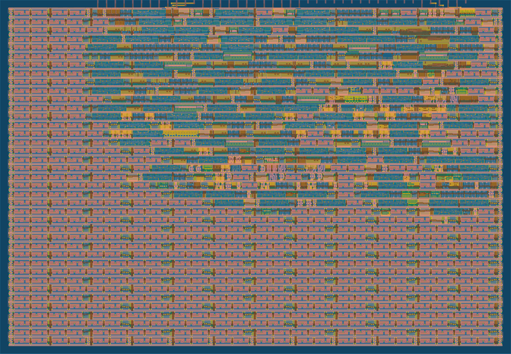
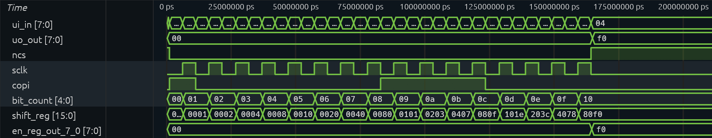
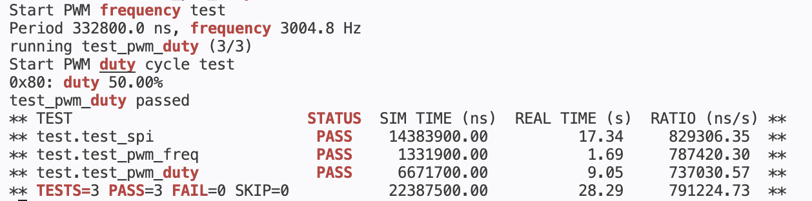
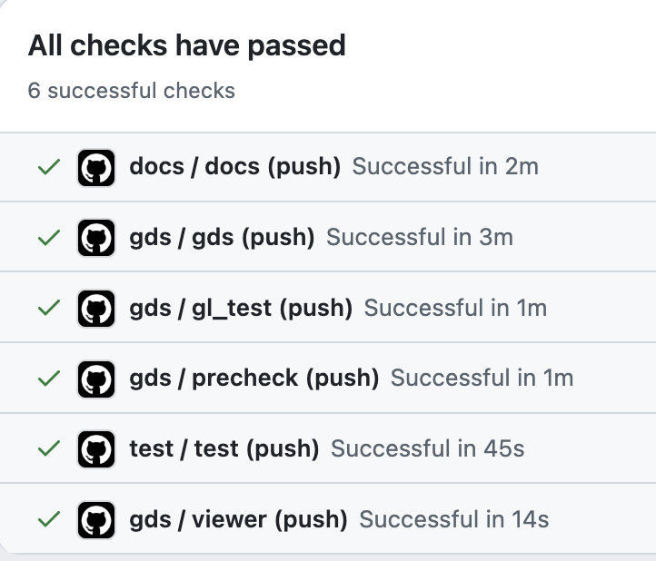

# SPI-Controlled PWM Peripheral (ASIC)

A small digital chip design: a microcontroller sends settings over SPI, and the chip drives 16 output pins as off, steady on, or PWM at about 3 kHz. Built in Verilog, verified with cocotb, and taken through the open-source ASIC flow (Yosys + OpenLane, Sky130 PDK) to a layout (GDS) that passes Tiny Tapeout's checks.

This was my onboarding project for [UWASIC](https://github.com/UW-ASIC), the University of Waterloo ASIC design team.



## What I built

- **SPI peripheral** (`src/spi_peripheral.v`): a write-only SPI mode 0 receiver. Two-flip-flop synchronizers bring SCLK, COPI and nCS into the 10 MHz clock domain; edge detection finds SCLK and nCS transitions; a shift register and bit counter collect the 16-bit frame; the target register updates only when nCS rises after exactly 16 bits, and reads or invalid addresses are ignored.
- **Integration** of the SPI peripheral with the provided PWM peripheral in the top module (`src/project.v`).
- **PWM testbench** (`test/test.py`): cocotb tests for frequency, duty cycle, the 0% and 100% edge cases, and the interaction between output-enable and PWM-enable.

Provided by the team template: the PWM peripheral (`src/pwm_peripheral.v`), the SPI test, and the Tiny Tapeout build setup.

## How it works

```
SPI controller ──SCLK/COPI/nCS──► SPI peripheral ──5 registers──► PWM peripheral ──► 16 output pins
(microcontroller)                 (synchronize,                    (3 kHz, duty =      uo_out[7:0]
                                   shift in 16 bits)                value / 256)       uio_out[7:0]
```

Each SPI frame is 16 bits, MSB first: 1 R/W bit (1 = write), 7-bit address, 8-bit data.

| Address | Register | Function |
|---|---|---|
| 0x00 | `en_reg_out_7_0` | Output enable for `uo_out[7:0]` |
| 0x01 | `en_reg_out_15_8` | Output enable for `uio_out[7:0]` |
| 0x02 | `en_reg_pwm_7_0` | PWM mode for `uo_out[7:0]` |
| 0x03 | `en_reg_pwm_15_8` | PWM mode for `uio_out[7:0]` |
| 0x04 | `pwm_duty_cycle` | Duty cycle (0x00 = 0%, 0xFF = 100%) |

Each bit controls one pin. Output enable takes priority: if it is 0, the pin is 0 regardless of PWM mode.

## Verification


*One SPI write (address 0x00, data 0xF0): 16 bits shift in on SCLK rising edges, then the register and output update when nCS goes high.*

| Test | Checks | Result |
|---|---|---|
| `test_spi` (provided) | Register writes, invalid addresses, reads ignored | Pass |
| `test_pwm_freq` | Frequency within 3 kHz ±1% | 3004.8 Hz |
| `test_pwm_duty` | 50% duty within ±1 point; 0x00 never high; 0xFF never low; output enable overrides PWM; PWM off gives a steady 1 | 50.00%, pass |



## Results

- All cocotb tests pass on the RTL and again on the synthesized gate-level netlist.
- GDS builds with no linter warnings and passes all 14 Tiny Tapeout prechecks (DRC, pins, layers).
- About 420 standard cells, roughly 28% of one Tiny Tapeout tile.



## Run the tests

Requires Icarus Verilog and cocotb (the repo's dev container has both).

```
cd test
make -B
```

## Tools

Verilog, cocotb (Python), Icarus Verilog, Yosys, OpenLane 2, Sky130 PDK, GitHub Actions, Surfer (waveforms).

## Credits

Based on the [UW-ASIC onboarding template](https://github.com/UW-ASIC/onboarding-start), built on the Tiny Tapeout project template. PWM peripheral by Damir Gazizullin.